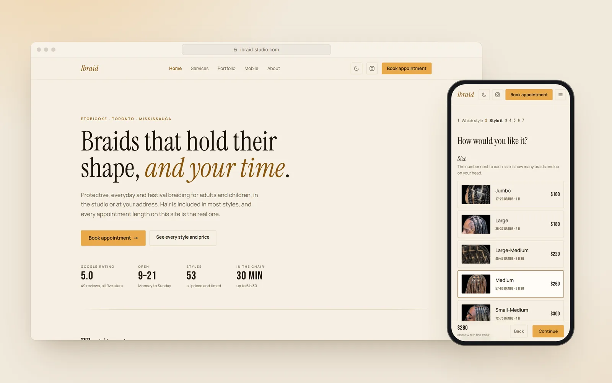
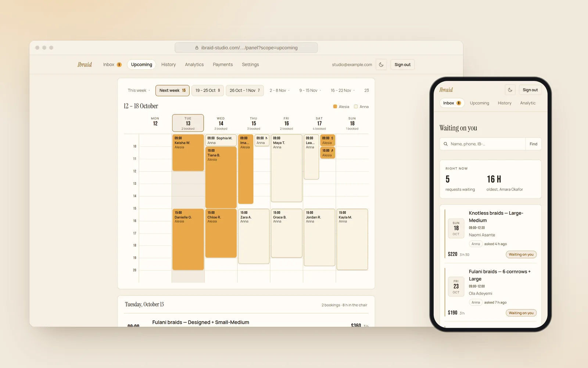
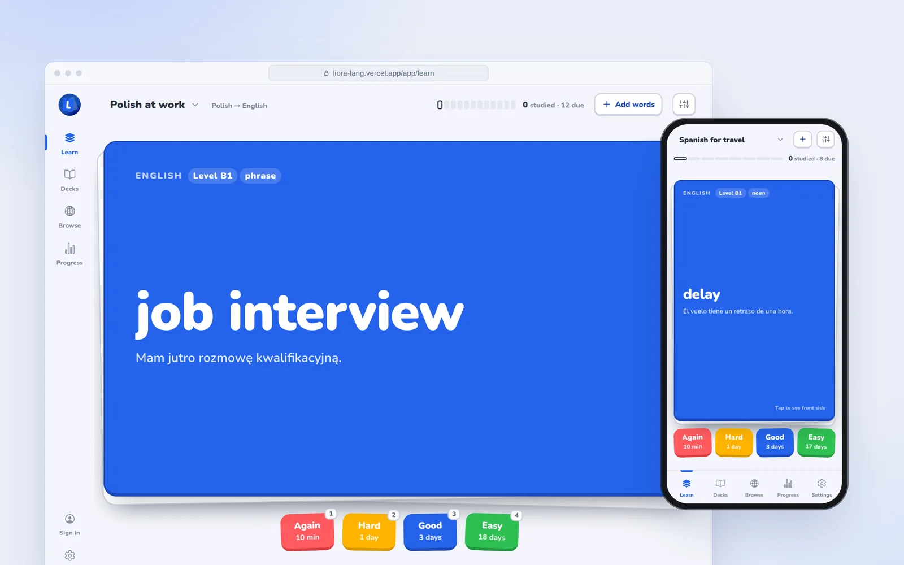
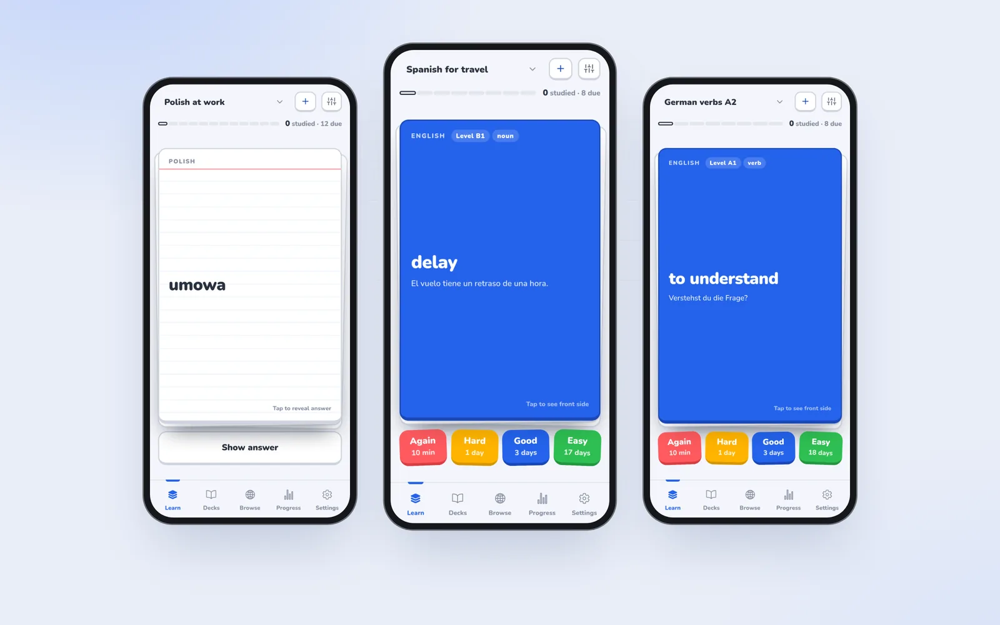

<h2 align="center">Hi, I'm Mark Storchovyi 👋</h2>

  Frontend developer · <b>React, Next.js, TypeScript</b> · Wrocław, Poland
   
  <b>Open to frontend roles, on-site or remote</b>

  
  
  

  

### iBraid Studio

Website, online booking and studio panel for a braiding studio in Toronto. Built solo, in production.

**~50 clients a month · 53 services · Stripe deposits · 700+ tests**

[Live site](https://www.ibraid-studio.com) · [Case study](https://mark-storchovyi.com/#case-study)

<table>
  <tr>
    <td width="50%" valign="top">
      <a href="https://www.ibraid-studio.com"><picture><source media="(prefers-color-scheme: dark)" srcset="assets/ibraid-site.webp"></picture></a>
       <b>Website and booking</b>
       Real prices and times, a 7-step booking with a deposit.
    </td>
    <td width="50%" valign="top">
      <a href="https://mark-storchovyi.com/#case-study"><picture><source media="(prefers-color-scheme: dark)" srcset="assets/ibraid-panel.webp"></picture></a>
       <b>Studio panel</b>
       Bookings, weekly calendar, payments, analytics. Confirm from Telegram in one tap.
    </td>
  </tr>
</table>

### LioraLang

Offline flashcards for learning languages with spaced repetition, on the web and on desktop. Decks can also cover programming, mathematics or history.

[Try it](https://liora-lang.vercel.app) · [Source](https://github.com/rorimark/LioraLang)

<table>
  <tr>
    <td width="50%" valign="top">
      <a href="https://liora-lang.vercel.app"><picture><source media="(prefers-color-scheme: dark)" srcset="assets/lioralang.webp"></picture></a>
       <b>Web and desktop</b>
       Each word with an example, its level and part of speech. Works offline.
    </td>
    <td width="50%" valign="top">
      <a href="https://liora-lang.vercel.app"><picture><source media="(prefers-color-scheme: dark)" srcset="assets/lioralang-phones.webp"></picture></a>
       <b>On a phone</b>
       Polish, Spanish and German decks, laid out for a phone.
    </td>
  </tr>
</table>
